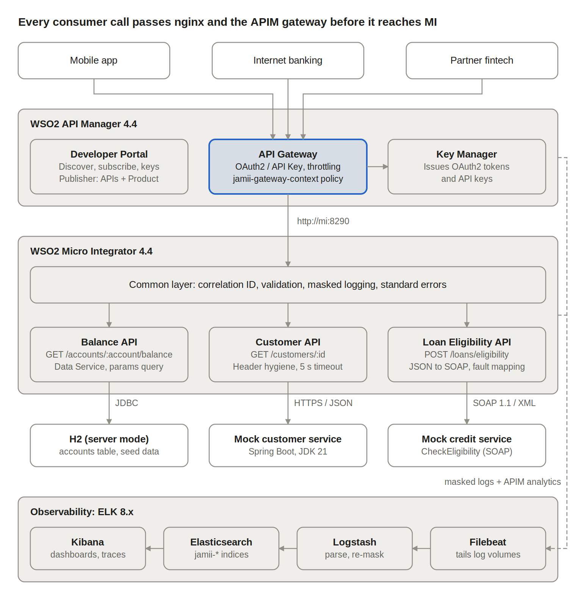
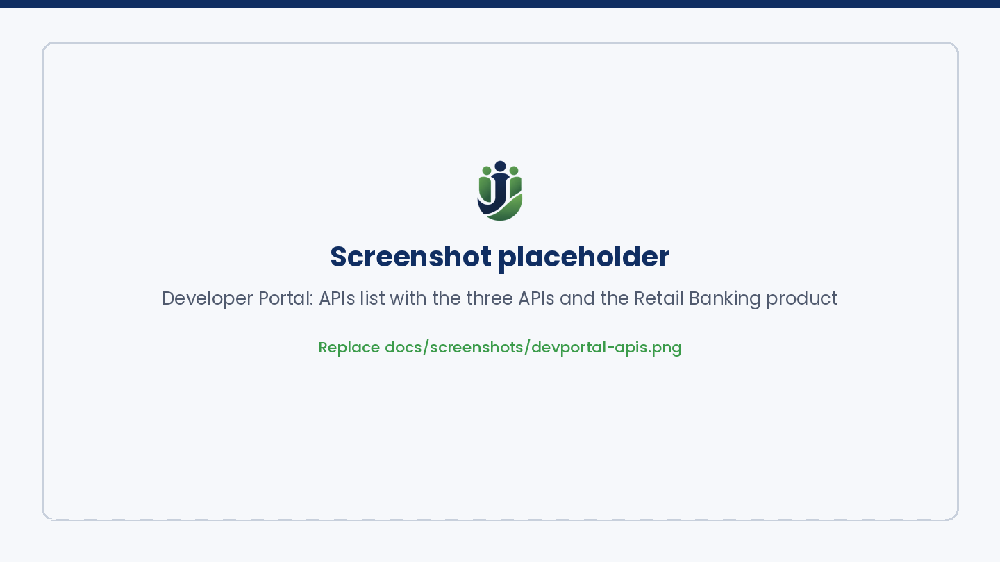
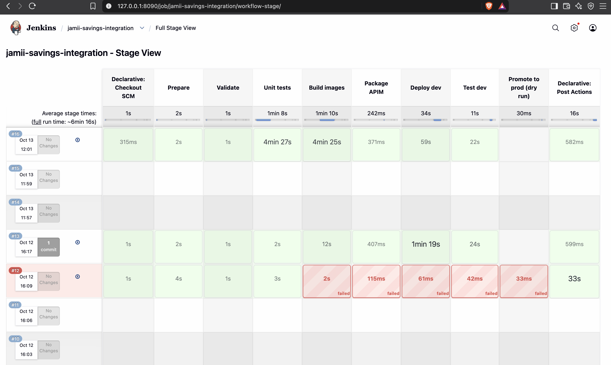
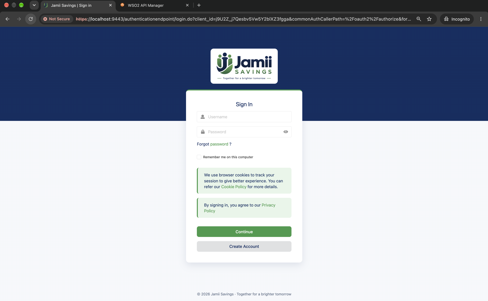
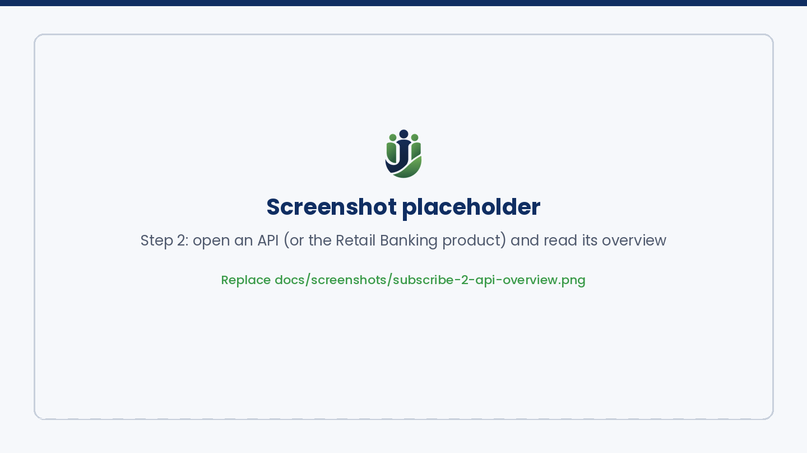
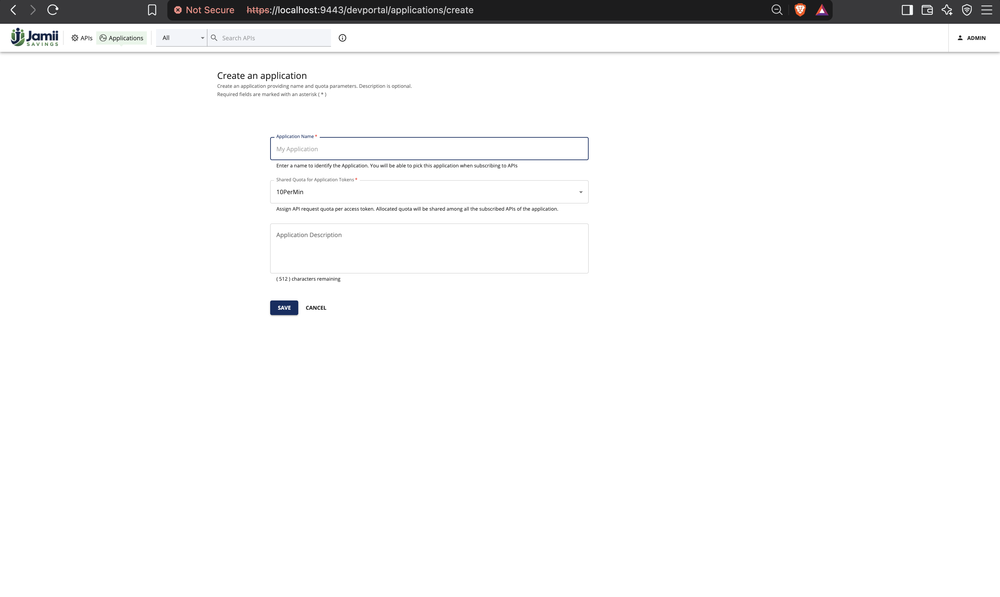
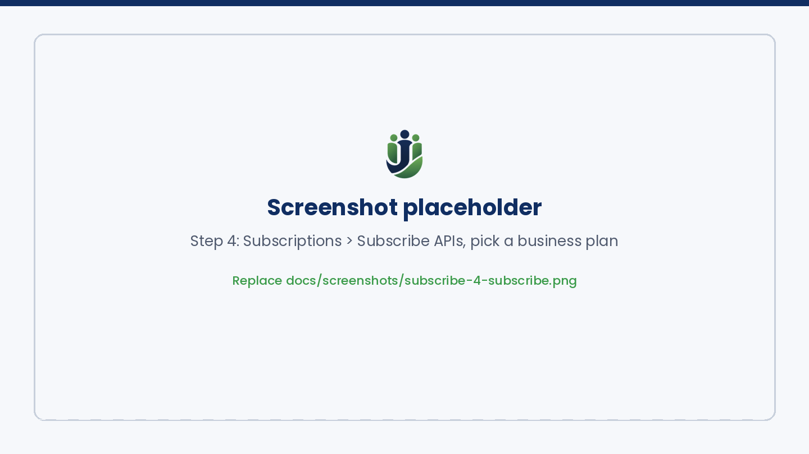
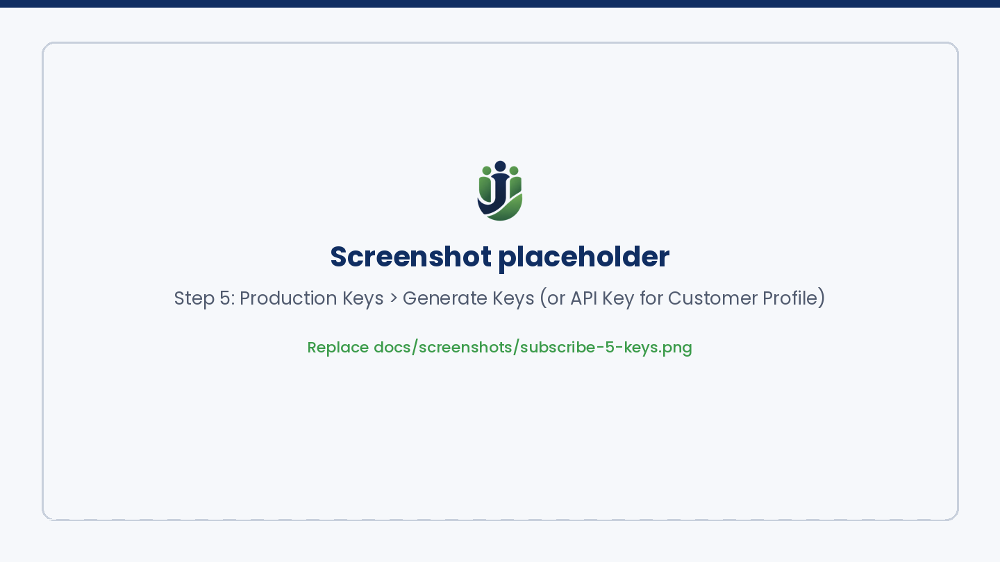
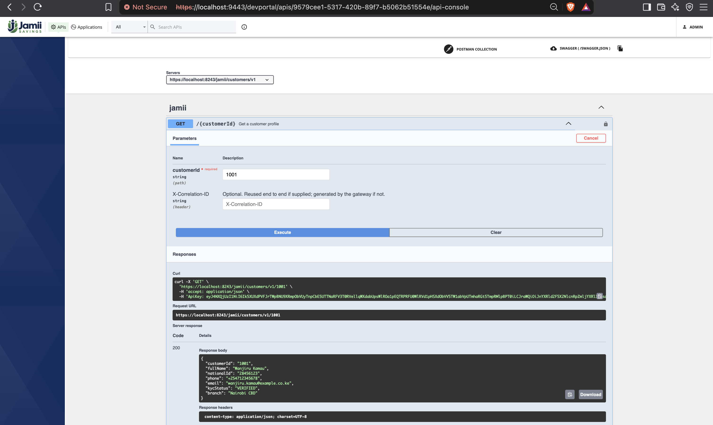

# Jamii Savings Integration Platform

Three integrations for the fictional Jamii Savings bank, built on **WSO2 Micro Integrator**, exposed and governed through **WSO2 API Manager** (both self-managed), and built and deployed by a single **Jenkins** pipeline.

| API | Method and path | Backend |
| --- | --- | --- |
| Account Balance | `GET /accounts/{accountNumber}/balance` | H2 database via MI Data Service |
| Customer Profile | `GET /customers/{customerId}` | Jamii mock customer service (Spring Boot, REST) |
| Loan Eligibility | `POST /loans/eligibility` | Jamii mock credit-check service (Spring Boot, SOAP) |

## Live environment (VPS)

Self-hosted on a Contabo VPS behind nginx (TLS terminated at nginx, one subdomain per service). **Status: deploying 11 Oct 2026.** Until then, everything runs locally with one command (next section).

| Service | URL | Access |
| --- | --- | --- |
| API gateway | https://api.jamii.daqiqtech.co.ke | Public (OAuth2 or API key) |
| Developer Portal | https://portal.jamii.daqiqtech.co.ke/devportal | Public; demo login shared separately |
| Publisher / Admin | https://apim.jamii.daqiqtech.co.ke/publisher | IP allowlist + login |
| MI Dashboard | https://mi.jamii.daqiqtech.co.ke/dashboard | IP allowlist + login |
| Jenkins | https://jenkins.jamii.daqiqtech.co.ke | IP allowlist + login |

Example: `curl -H "Authorization: Bearer <token>" https://api.jamii.daqiqtech.co.ke/jamii/accounts/v1/0123456789/balance`

## Quick start: everything, end to end

```bash
cp .env.example .env              # set the passwords; COMPOSE_PROFILES=core is the default stack
cd dist && sha256sum wso2mi-4.3.0.zip wso2am-4.4.0.zip > checksums.txt && cd ..
scripts/up.sh
```

`scripts/up.sh` runs `docker compose up`, which builds and starts the mock backends, H2, MI and API Manager. Once API Manager is healthy, the one-shot `apim-init` container publishes the throttling tier, the three APIs, the API Product and the demo app, then runs the gateway checks. Its exit code is the result.

A plain `docker compose up -d --build` does the same; follow progress with `docker compose logs -f apim-init`. Re-publish at any time with `docker compose run --rm apim-init`.

## Architecture



Consumers call **API Manager** (security, throttling, the gateway policy, the Developer Portal). The gateway forwards to **Micro Integrator**, which does the integration work: a Data Service on H2 for balances, a managed proxy for customer profiles, and JSON-to-SOAP mediation for loan eligibility. MI is never exposed directly. **Jenkins** validates, tests, builds and deploys both layers as one release.

| Diagram | |
| --- | --- |
| [High-level design](docs/diagrams/hld.png) | Layers, runtimes and versions |
| [Edge topology](docs/diagrams/edge-topology.png) | nginx subdomains, what is public and what is allowlisted |
| [Loan eligibility sequence](docs/diagrams/loan-sequence.png) | JSON in, SOAP to the credit engine, fault mapping, JSON out |
| [Pipeline](docs/diagrams/pipeline.png) | Jenkins stages, approval gate and rollback |

**Developer Portal** (Jamii-branded API Manager 4.4):



**Jenkins** (one pipeline for all three APIs):



Full design: [Solution Design Document](docs/Jamii_Savings_Solution_Design_v1.5.pdf) · Requirements: [BRD](docs/Jamii_Savings_BRD_v1.5.pdf) · Plan: [Jira plan](docs/jamii-jira-plan.xlsx)

## Backend choices

Both non-database backends are provided by the **mock backends** in `mock-backends/`: a Spring Boot service (JDK 21, Maven, executable jar) with its own Dockerfile. It runs as the `mock-backends` service of this stack, and can also be deployed on its own with `mock-backends/docker-compose.yml`. Swagger UI: http://localhost:8081/swagger-ui.html

**Why a self-built mock instead of an existing public API.** The brief suggests existing public mock and SOAP test services. I chose to build the backends because the integration layer's value is in how it handles real behaviour, and public services cannot produce that behaviour on demand:

- **Bank-shaped data.** Customer records carry a national ID, +254 phone number and KYC status, so the masking layer is tested on the PII a bank actually holds.
- **Every failure mode, deterministically.** Specific IDs return 404, 500, a SOAP client fault, a SOAP server fault, or a delay longer than MI's timeout. Every error mapping in the BRD can be demonstrated live.
- **Leaky headers.** Responses include `Server`, `X-Powered-By` and `X-Internal-*` headers, so header stripping is proven, not assumed.
- **A meaningful SOAP contract.** `CheckEligibility` (XSD and WSDL at `/ws/creditCheck.wsdl`) is a credit-check operation, not a calculator repurposed as one.
- **No third-party outages or quotas** during the pipeline run or the recording.

The trade-off is one more service to build and run, and a deliberate departure from the "existing public" wording, which is why it is explained here.

| Backend | Endpoint | Rules |
| --- | --- | --- |
| Customer system (REST) | `GET /customers/{id}` | 1001-1005: 200; 9999: 404; 5000: 500; 5004: 7 s delay |
| Credit-check engine (SOAP 1.1) | `POST /ws` (`CheckEligibility`) | normal: decision and debt-to-income %; income 0 or customer 6000: soap:Client; customer 5000: soap:Server; customer 5004: 12 s delay |

## Architecture decisions and trade-offs

The design document records 22 decisions (§ ADR log). The ones that shape the build most:

| Decision | Trade-off |
| --- | --- |
| Self-managed WSO2 (MI 4.3.0 and APIM 4.4.0 on JDK 17), images built from the downloaded distributions | Full control of versions and configuration; more to build and patch than vendor images |
| H2 in its own container (server mode) | Stopping it demonstrates the 503 `DB_UNAVAILABLE` path live |
| Self-built Spring Boot mock backends | Deterministic data, faults and delays; one more service, and a departure from "existing public" (see Backend choices) |
| One error envelope for every API, whatever the backend | Consumers handle one shape; MI maps every backend fault to it |
| Two-layer log masking: whitelisted log fields plus a log-format rule masking any 10+ digit number | No Java code, and it also covers MI's own internal logs; rule-based rather than field-aware |
| API definitions as apictl projects in Git, published by a one-shot `apim-init` container | Reproducible from nothing in one `docker compose up`; one more image |
| API Product at an explicit version 1, as the default version | Found by experiment: the implicit 1.0.0 had no default route and its versioned route failed authentication |
| One application per access model (`jamii-channel` for the product, `jamii-mobile` for individual APIs) | Two sets of keys; subscriptions never overlap |
| Validate everything before deploying anything; roll the whole release back on failure | A release is one set of images with one tag, so rollback restores MI and APIM together |
| Pipeline tests run against the deployed stack (mock JUnit, MI smoke, gateway checks) instead of MI unit tests | Tests hit real faults, timeouts and the database; they run after deployment rather than before |

## Throttling tiers

| API | Tiers offered | Why |
| --- | --- | --- |
| Account Balance | Gold, Unlimited | Fast, local database lookup |
| Customer Profile | Gold, Unlimited | Read-only lookup against the customer system |
| Loan Eligibility | **LoanCheck10PerMin** (custom), Gold | Each call depends on an external credit engine with no SLA and up to 10 s latency, so it gets a tight, custom quota: 10 requests a minute per subscription. Over the quota the gateway returns 429. |
| Retail Banking (product) | Gold | One subscription for Jamii's own channel apps |

## How to run locally

Prerequisites: Docker Desktop (Compose 2.24 or later) with 10–12 GB of memory, and the WSO2 zips (`wso2mi-4.3.0.zip`, `wso2am-4.4.0.zip`, `wso2mi-dashboard-4.2.0.zip`) in `dist/`. Nothing else: Maven, apictl, curl and jq all run inside containers.

```bash
cp .env.example .env                 # set the passwords
cd dist && sha256sum wso2mi-4.3.0.zip wso2am-4.4.0.zip wso2mi-dashboard-4.2.0.zip > checksums.txt && cd ..
scripts/up.sh                        # build, start, publish and verify: about 10 minutes the first time
```

Then: Developer Portal https://localhost:9443/devportal · Publisher https://localhost:9443/publisher · gateway https://localhost:8243 · MI Dashboard https://localhost:9743/dashboard (MI's admin login) · mock Swagger UI http://localhost:8081/swagger-ui.html. Demo credentials are written to `.apim-demo.env`.

```bash
. ./.apim-demo.env
TOKEN=$(curl -sk -u "$CONSUMER_KEY:$CONSUMER_SECRET" -d grant_type=client_credentials $TOKEN_URL | jq -r .access_token)
curl -sk -H "Authorization: Bearer $TOKEN" https://localhost:8243/jamii/accounts/v1/0123456789/balance
curl -sk -H "ApiKey: $API_KEY" https://localhost:8243/jamii/customers/v1/1001
curl -sk -H "Authorization: Bearer $TOKEN" -H 'Content-Type: application/json' \
  -d '{"customerId":"1001","monthlyIncome":120000,"existingMonthlyDebt":15000,"requestedMonthlyInstalment":25000}' \
  https://localhost:8243/jamii/loans/v1/eligibility
```

## Run Micro Integrator locally

2. Put the MI zip in `dist/` and record its checksum: `cd dist && sha256sum wso2mi-*.zip > checksums.txt`
3. `cp .env.example .env` and set `MI_VERSION` to the version you downloaded, plus the H2 password.
4. Build and start H2 and MI with MI's port 8290 exposed for testing:
   ```bash
   docker compose -f docker-compose.yml -f docker-compose.debug.yml --profile core up -d --build h2 mi
   docker compose logs -f mi        # wait for "WSO2 Micro Integrator started"
   ```
5. Run the smoke test: `scripts/mi-smoke.sh` (add `http://localhost:8290 --with-slow` to include the 504 timeouts).

| Artifact | Purpose |
| --- | --- |
| `apis/BalanceAPI.xml` | 1a: H2 lookup via `AccountsDataService`, envelope, 400/404/503 |
| `apis/CustomerAPI.xml` | 1b: managed proxy to the mock customer system, header hygiene, 404/502/503/504 |
| `apis/LoanEligibilityAPI.xml` | 1c: JSON to SOAP `CheckEligibility` and back, fault mapping 422/502/503/504 |
| `sequences/Common_InSeq.xml` | Correlation ID (reuse or generate), start time |
| `sequences/Common_HeaderHygiene.xml` | Strips internal and server headers both ways |
| `sequences/Common_FaultSeq.xml` | Classifies timeouts, connection failures, bad JSON, other errors |
| `templates/Common_ErrorResponse.xml` | Standard error body, status, correlation header |
| `templates/Common_MaskedLog.xml` | One masked log line per stage |
| `data-services/AccountsDataService.dbs` | Parameterised query; DB settings from environment |

## Run API Manager locally

1. Put `wso2am-4.4.0.zip` in `dist/` and refresh the checksums: `cd dist && sha256sum wso2mi-4.3.0.zip wso2am-4.4.0.zip > checksums.txt`
2. Set `APIM_VERSION=4.4.0`, `APIM_ADMIN_USER` and `APIM_ADMIN_PASSWORD` in `.env`.
3. Build (the build log shows what the branding step changed), then start:
   ```bash
   docker compose build --progress=plain apim 2>&1 | grep configure:
   docker compose -f docker-compose.yml -f docker-compose.debug.yml --profile core up -d apim
   ```
4. Open the Developer Portal at https://localhost:9443/devportal and the Publisher at https://localhost:9443/publisher (self-signed certificate warning expected).

**Branding.** `docker/apim/branding/` holds the Jamii Savings theme: logos (full colour and white), favicon, landing banners, and theme overrides for the Developer Portal (`userTheme.js`), Publisher and Admin Portal (`userCustomThemes.js`). Palette: navy `#102E62`, green `#3B9B4A`, light green `#5BBE61`, dark green `#2F7F3E`, white `#FFFFFF`.

## Publish the APIs

Needs `curl`, `jq` and `apictl` 4.4 (`brew install jq`; apictl from the WSO2 API Controller download page).

```bash
scripts/apim-bootstrap.sh          # tier, 3 APIs, API Product, demo app + keys (safe to re-run)
scripts/gateway-check.sh           # end-to-end checks through the gateway
```

| Artifact | Location |
| --- | --- |
| OpenAPI 3.0 specs (shared `ErrorResponse`) | `apim/apis/*/Definitions/swagger.yaml` |
| apictl projects (security, tiers, endpoints, tile) | `apim/apis/*` |
| Gateway policy `jamiiGatewayContext` (Balance API) | `apim/apis/JamiiAccountBalance-v1/Policies/` |
| Endpoints per environment | `apim/params/{dev,prod}/*.yaml` |
| Custom tier `LoanCheck10PerMin` | `apim/throttling/` |
| API Product `JamiiRetailBanking` | `apim/products/JamiiRetailBanking/` |

| API | Security | Tiers |
| --- | --- | --- |
| JamiiAccountBalance | OAuth2 | Gold, Unlimited |
| JamiiCustomerProfile | API key | Gold, Unlimited |
| JamiiLoanEligibility | OAuth2 | LoanCheck10PerMin, Gold |
| JamiiRetailBanking (product) | OAuth2 | Gold |

The API Product is version `1` and the default version, so it answers both with and without the version: `https://localhost:8243/jamii/retail-banking/{accountNumber}/balance` (or `/jamii/retail-banking/1/...`), `/jamii/retail-banking/{customerId}`, `/jamii/retail-banking/eligibility`. Note: a product left at API Manager's implicit version `1.0.0` was not served as the default version and its versioned route failed authentication (900900), so the version is set explicitly. It is used by its own application (`jamii-channel`); an application uses either the product or the individual APIs, never both.

Loan eligibility gets a tighter tier because each call depends on a slow external credit engine with no SLA.

## CI/CD: Jenkins

```bash
# .env: set JENKINS_ADMIN_PASSWORD (and JAMII_REPO_URL if you build from GitHub instead of this folder)
docker compose --profile ci up -d --build jenkins
```
Open http://localhost:8090 and sign in. The job **jamii-savings-integration** already exists (configuration as code); press **Build with Parameters**. Jenkins checks out the committed state of this repo (`file:///src`, branch `main`) unless `JAMII_REPO_URL` points elsewhere. Locally, start builds by hand (**Build with Parameters**).

**Push trigger (on the VPS).** Once GitHub can reach Jenkins, add `triggers { githubPush() }` to the `Jenkinsfile` (the `github` plugin is already in `docker/jenkins/plugins.txt`), then:

1. In GitHub: **Settings → Webhooks → Add webhook**, payload URL `https://jenkins.jamii.daqiqtech.co.ke/github-webhook/`, content type `application/json`, **Just the push event**, with a webhook secret.
2. Store the secret as a Jenkins credential and reference it in the GitHub plugin configuration (`casc.yaml`), so Jenkins rejects requests that are not signed by GitHub.
3. In nginx, open only `/github-webhook/` to GitHub's webhook address ranges (published at `https://api.github.com/meta`, key `hooks`); the rest of Jenkins stays behind the IP allowlist.
4. Set the Jenkins URL in `casc.yaml` to `https://jenkins.jamii.daqiqtech.co.ke/`.

| Stage | What it does |
| --- | --- |
| Prepare | Copies the WSO2 zips from `dist/`; release tag = build number |
| Validate | MI XML, the three OpenAPI specs and apictl projects (one loop over all APIs), shell scripts, compose config. Nothing is deployed unless everything validates |
| Unit tests | Mock backends' 17 JUnit tests (Maven inside Docker), published as JUnit results |
| Build images | mock-backends, H2, MI (artifacts baked in), API Manager, apim-init, all tagged with the build number |
| Package APIM | The apictl projects archived as `jamii-apim-<tag>.tgz` |
| Deploy dev | MI and its dependencies, then API Manager, then apim-init publishes tier, APIs, product and demo apps |
| Test dev | MI smoke (19 checks incl. timeouts), gateway checks (14), and a check that no PII reaches MI logs |
| Promote to prod | Only with `PROMOTE_TO_PROD`: manual approval, then a dry run of the prod imports |

**Failure and rollback.** On any failure after deployment starts, the pipeline restores the last release that passed: the same images by tag, and its API definitions (re-imported by that release's apim-init). To demonstrate it, run once normally, then run with `FORCE_FAIL_IMPORT`: the Loan API points at a tier that does not exist, the import fails, and the previous release comes back.

Jenkins runs as root with the host Docker socket mounted: acceptable for this local demo, not for a shared server.

## Postman collection

`docs/postman/` holds a collection covering every endpoint (APIM gateway, MI direct, MI management API, and the Spring Boot mock backends) with example responses, plus environments for localhost and the nginx hostnames. After `apim-bootstrap.sh` (or `apim-init`) has run, import the collection and **`docs/postman/Jamii-dev-localhost.generated.postman_environment.json`**: it already contains the demo apps' keys and API key (and is gitignored). Turn off SSL certificate verification (self-signed certificates) and run `0. Auth` first. The API Product requests use their own token (`jamii-channel`).

## Developer Portal: discover and subscribe

How a developer at a partner or a Jamii channel team starts using the APIs:

**1. Sign in** at the Developer Portal with your account.



**2. Find an API.** The home page lists Account Balance, Customer Profile, Loan Eligibility and the **Jamii Retail Banking** product. Each has an overview, the OpenAPI definition, and its business plans. Channel apps should take the product (one subscription, all three APIs); partners subscribe to individual APIs.



**3. Create an application** under **Applications → Add New Application** (name, description, application-level quota).



**4. Subscribe.** In the application, open **Subscriptions → Subscribe APIs**, choose the API or product and a business plan (Gold, or `LoanCheck10PerMin` for Loan Eligibility).



**5. Get credentials.** Under **Production Keys → Generate Keys** for OAuth2 (Account Balance, Loan Eligibility, the product), or **API Key → Generate Key** for Customer Profile.



**6. Try it.** Use **Try Out** on the API page, or call the gateway yourself:



```bash
TOKEN=$(curl -sk -u "<consumer key>:<consumer secret>" -d grant_type=client_credentials https://localhost:9443/oauth2/token | jq -r .access_token)
curl -sk -H "Authorization: Bearer $TOKEN" https://localhost:8243/jamii/retail-banking/0123456789/balance
```

Every response carries an `X-Correlation-ID` (send your own to trace a call end to end), and every error uses the same body: `{"error":{"code","message","httpStatus","details"},"requestId","timestamp"}`.

## Assumptions

- **Synthetic data only.** All accounts, customers and income figures are invented; no real customer data is used anywhere.
- **Backends are mocks.** The customer system and the credit engine are Jamii-owned mocks whose contracts (REST JSON, SOAP `CheckEligibility`) stand in for real systems; MI talks to them exactly as it would to the real ones.
- **Single-node, all-in-one WSO2.** One MI and one API Manager (gateway, key manager, portals together) are enough for the assignment; production would separate and cluster them.
- **H2 stands in for the core banking database.** It is recreated from schema and seed on every start.
- **Kenyan shillings and +254 numbers.** Currency is KES; IDs and phone formats are Kenyan.
- **Loan rule.** Eligible when total monthly debt, including the new instalment, is at most 40% of monthly income.
- **Secrets.** Kept in `.env` locally and in Jenkins credentials; a production setup would use a secrets manager.
- **Dev and prod.** The pipeline deploys to dev; prod is an approval-gated dry run, since there is one host.
- **Free, local tooling.** Self-signed certificates locally; TLS at nginx on the VPS.

## What I would do differently with more time

- **Monitoring with ELK.** The design is ready (§ observability): Filebeat ships MI, API Manager and mock-backend logs to Logstash, which re-masks PII as a second safeguard, into Elasticsearch, with Kibana dashboards for traffic, errors by code, latency and throttling, searchable by correlation ID. It is the next piece I would build.
- **Alerting.** Alerts on error rate, 5xx from the credit engine, and 429 spikes, wired to the team's channel.
- **MI unit tests and a CAR build.** Add MI unit-test suites with mocked endpoints and package a `.car` with the WSO2 Maven plugins, alongside the image.
- **Production topology.** Separate gateway, key manager and portals; two MI nodes behind a load balancer; a production database instead of API Manager's embedded one.
- **Secrets management.** Move passwords and keys into a vault and rotate them; add a webhook secret for the GitHub push trigger.
- **Real environments.** Separate dev, staging and prod hosts, with the prod stage doing the real imports instead of a dry run.
- **Contract tests in CI.** Validate MI responses against the OpenAPI schemas on every build.

## Demo recording

5-minute walkthrough: **link to be added**.

1. The architecture in one picture, and why the backends are self-built.
2. One `docker compose up`: the stack starts, publishes and verifies itself.
3. The Developer Portal: discover, subscribe, get a token, call each API.
4. Error handling: unknown account (404), database down (503), credit engine fault (422 / 502), timeout (504), all in one error format.
5. Throttling: the Loan tier returning 429 after 10 calls.
6. Jenkins: a green run, then a forced import failure rolling back to the previous release.
